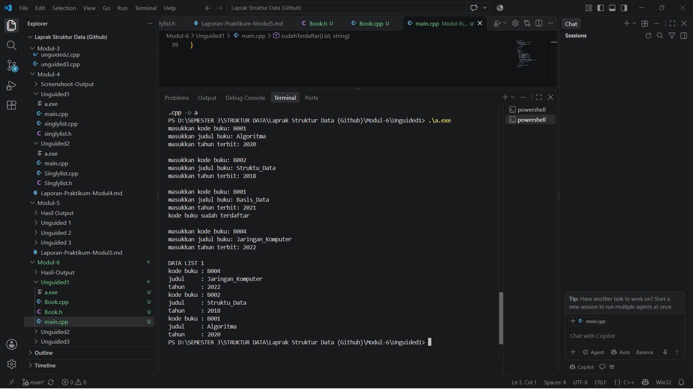
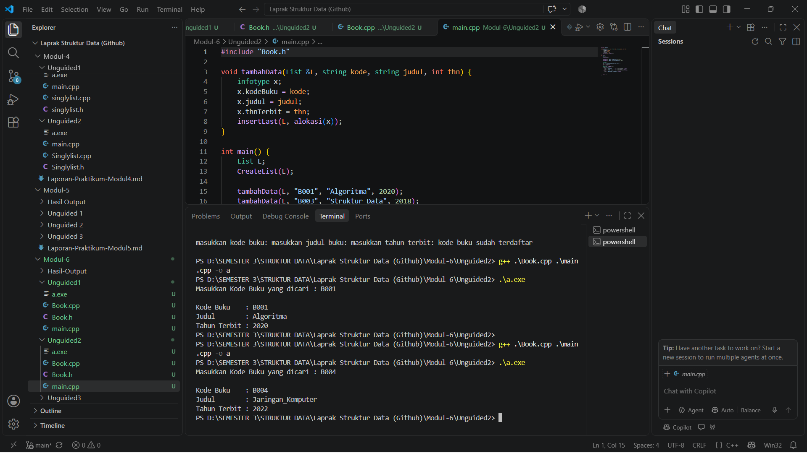
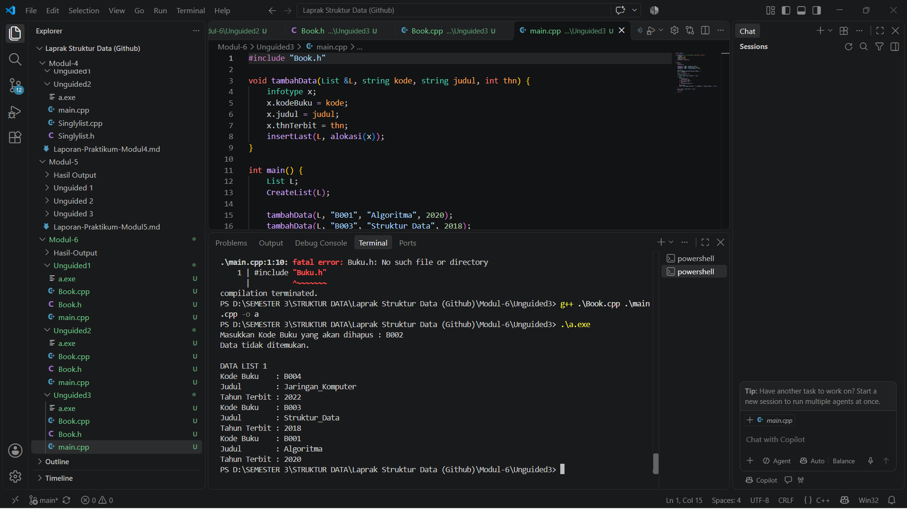

# <h1 align="center">Laporan Praktikum Modul 6 - DOUBLY LINKED LIST</h1>
<p align="center">Andhista Novian Firzatullah - 109082500092</p>

## Dasar Teori

A. Doubly Linked List
Doubly linked list adalah struktur data linier yang setiap node-nya memiliki dua pointer, yaitu next yang menunjuk ke node berikutnya dan prev yang menunjuk ke node sebelumnya [5].
Berbeda dengan singly linked list yang hanya memiliki pointer ke node berikutnya, doubly linked list memungkinkan penelusuran dua arah (maju dan mundur), sehingga penyisipan dan penghapusan data menjadi lebih mudah [5].
Setiap node terdiri dari tiga bagian, yaitu data (info), pointer next, dan pointer prev.
List menyimpan dua penunjuk, yaitu First yang menunjuk node pertama dan Last yang menunjuk node terakhir. List kosong jika First bernilai Nil (NULL).
Pointer prev pada node pertama dan pointer next pada node terakhir bernilai Nil sebagai penanda ujung list.
B. Abstract Data Type (ADT) Doubly Linked List
ADT mendefinisikan struktur data beserta operasi-operasinya sebagai satu kesatuan.
Pada tugas ini, ADT dipisah menjadi file header (.h) yang berisi tipe data dan prototype fungsi, serta file implementasi (.cpp) yang berisi isi fungsi, lalu diuji pada file main.cpp.
Struktur yang digunakan: infotype: data yang disimpan (misalnya kode buku, judul, tahun terbit) ElmList: node (berisi info, next, dan prev) address: pointer ke ElmList List: struktur yang berisi First dan Last
C. Operasi Dasar dan Penambahan Data
Operasi dasar meliputi CreateList untuk membuat list kosong (First dan Last diisi Nil), alokasi untuk membuat node baru secara dinamis dengan operator new, dealokasi untuk membebaskan memori dengan operator delete, dan printInfo untuk menampilkan data dengan menelusuri list. Fungsi insertLast menambahkan node di akhir list: jika list kosong, node baru menjadi First sekaligus Last, jika tidak, prev node baru diarahkan ke Last lama, next Last lama diarahkan ke node baru, lalu Last diperbarui. Penyisipan pada doubly linked list dapat dilakukan di awal, di akhir, maupun di tengah list [5].

D. Searching pada Doubly Linked List
Searching dilakukan dengan menelusuri node dari First menggunakan pointer next sambil membandingkan data yang dicari (pada tugas ini kodeBuku atau nopol) dengan info pada setiap node. Fungsi findElm mengembalikan alamat node yang cocok, atau Nil jika tidak ditemukan. Metode ini disebut linear search dengan kompleksitas waktu O(n), karena pada kasus terburuk seluruh node harus diperiksa. Pada tugas ini, pencarian juga dipakai untuk mengecek duplikasi sebelum data baru dimasukkan.

E. Penghapusan Data (Delete)
Penghapusan pada doubly linked list dapat dilakukan di awal, di akhir, maupun di tengah list [5]. deleteFirst melepas node pertama lalu memajukan First, deleteLast melepas node terakhir lalu memundurkan Last, dan deleteAfter melepas node yang berada tepat setelah node Prec dengan menyambungkan kembali pointer next dan prev di sekitarnya. Jika list hanya berisi satu node, First dan Last dikembalikan menjadi Nil. Keberadaan pointer prev membuat node sebelumnya dapat dicapai langsung tanpa penelusuran ulang dari awal, sehingga penghapusan menjadi lebih efisien dibanding singly linked list. Setelah node dilepas, memorinya dibebaskan dengan dealokasi.
## Guided 

### 1.Program Doublylinkedlist
```C++
// File: doublylist.h
#ifndef DOUBLYLIST_H
#define DOUBLYLIST_H

#include <iostream>
#include <string>

#define Nil NULL

// Latihan 1
struct infotype {
    std::string nopol; 
    std::string warna; 
    int thnBuat;      
};
typedef struct elmlist *address;
struct elmlist {
    infotype info;  
    address next;   
    address prev;   
};
struct List {
    address First; 
    address Last;  
};


// Latihan 1
void CreateList(List &L);
address alokasi(infotype x);
void dealokasi(address &P);
void printInfo(List L);
void insertLast(List &L, address P);

// Latihan 2

address findElm(List L, std::string nopol);

// Latihan 3
void deleteFirst(List &L, address &P);
void deleteLast(List &L, address &P);
void deleteAfter(List &L, address Prec, address &P);
void deleteElm(List &L, std::string nopol, bool &status);

#endif
// File: doublylist.cpp
#include "doublylist.h"

// Latihan 1
void CreateList(List &L) {
    L.First = Nil;
    L.Last = Nil;
}

address alokasi(infotype x) {
    address P = new elmlist;
    P->info = x;
    P->next = Nil;
    P->prev = Nil; 
    return P;
}

void dealokasi(address &P) {
    delete P;
}

void printInfo(List L) {
    address P = L.Last;
    if (P == Nil) {
        std::cout << "List kosong." << std::endl;
        return;
    }
    while (P != Nil) {
        std::cout << "no polisi : " << P->info.nopol << std::endl;   
        std::cout << "warna     : " << P->info.warna << std::endl;   
        std::cout << "tahun     : " << P->info.thnBuat << std::endl; 
        P = P->prev;
    }
}

void insertLast(List &L, address P) {
    if (L.First == Nil) { 
        L.First = P;
        L.Last = P;
    } else {
        P->prev = L.Last;         
        (L.Last)->next = P;     
        L.Last = P;               
    }
}

// Latihan 2
address findElm(List L, std::string nopol) {
    address P = L.First;
    while (P != Nil) {
        if (P->info.nopol == nopol) {
            return P;
        }
        P = P->next;
    }
    return Nil;
}

// Latihan 3
void deleteFirst(List &L, address &P) {
    if (L.First == Nil) return;

    P = L.First; 
    if (L.First == L.Last) { 
        L.First = Nil;
        L.Last = Nil;
    } else {
        L.First = P->next;     
        (L.First)->prev = Nil; 
        P->next = Nil;         
    }
}

void deleteLast(List &L, address &P) {
    if (L.First == Nil) return;

    P = L.Last; 
    if (L.First == L.Last) { 
        L.First = Nil;
        L.Last = Nil;
    } else {
        L.Last = P->prev;      
        (L.Last)->next = Nil; 
        P->prev = Nil;         
    }
}

void deleteAfter(List &L, address Prec, address &P) {
    if (Prec == Nil || Prec->next == Nil) return;

    P = Prec->next;
    if (P == L.Last) {
        deleteLast(L, P);
    } else {
        Prec->next = P->next;     
        (P->next)->prev = Prec; 
        P->next = Nil;            
        P->prev = Nil;           
    }
}

void deleteElm(List &L, std::string nopol, bool &status) {
    address P = findElm(L, nopol);
    status = false;

    if (P != Nil) {
        if (P == L.First) {
            deleteFirst(L, P);
        } else if (P == L.Last) {
            deleteLast(L, P);
        } else {
            address Prec = P->prev;
            deleteAfter(L, Prec, P);
        }
        dealokasi(P); 
        status = true;
    }
}
// File: main.cpp
#include <iostream>
#include "Doublylist.h"
using namespace std;

void inputData(List &L) {
    infotype data;
    address P;

    cout << "masukkan nomor polisi: "; cin >> data.nopol;
    cout << "masukkan warna kendaraan: "; cin >> data.warna;
    cout << "masukkan tahun kendaraan: "; cin >> data.thnBuat;
    if (findElm(L, data.nopol) == Nil) {
        P = alokasi(data); 
        insertLast(L, P);  
    } else {
        cout << "nomor polisi sudah terdaftar" << endl; 
    }
}

int main() {
    List L;
    CreateList(L); 
    address P;

    // Latihan 1
    inputData(L); 
    inputData(L); 
    inputData(L); 
    inputData(L); 

    cout << "\nDATA LIST 1" << endl; 
    printInfo(L); 

    // Latihan 2
    string nopolCari;
    cout << "\nMasukkan Nomor Polisi yang dicari : "; 
    cin >> nopolCari; 
    
    P = findElm(L, nopolCari); 
    if (P != Nil) {
        cout << "Nomor Polisi : " << P->info.nopol << endl; 
        cout << "Warna        : " << P->info.warna << endl; 
        cout << "Tahun        : " << P->info.thnBuat << endl; 
    } else {
        cout << "Data dengan nomor polisi " << nopolCari << " tidak ditemukan." << endl;
    }

    // Latihan 3
    string nopolHapus;
    bool hapusBerhasil;
    cout << "\nMasukkan Nomor Polisi yang akan dihapus : ";
    cin >> nopolHapus;

    deleteElm(L, nopolHapus, hapusBerhasil); 

    if (hapusBerhasil) {
        cout << "Data dengan nomor polisi " << nopolHapus << " berhasil dihapus." << endl; 
    } else {
        cout << "Data dengan nomor polisi " << nopolHapus << " tidak ditemukan." << endl;
    }
    cout << "\nDATA LIST 1" << endl; 
    printInfo(L); 

    return 0;
}

```
Program ini menyimpan data buku (kode, judul, tahun terbit) dalam doubly linked list. buku.h berisi struktur data dan daftar fungsi, buku.cpp berisi isi fungsinya (buat list, alokasi, cetak, tambah di akhir, cari, dan tiga jenis hapus), dan bukumain.cpp menjalankan alurnya: input data dengan pengecekan kode ganda, mencari satu buku, lalu menghapus satu buku.
## Unguided 

### 1. Program ADT Doubly Linked List - Insert First

```C++

File: Book.h
#ifndef BUKU_H_INCLUDED
#define BUKU_H_INCLUDED

#include <iostream>
#include <string>
using namespace std;

struct buku {
    string kodeBuku;
    string judul;
    int thnTerbit;
};
typedef buku infotype;

typedef struct ElmList *address;
struct ElmList {
    infotype info;
    address next;
    address prev;
};

struct List {
    address First;
    address Last;
};

void CreateList(List &L);
address alokasi(infotype x);
void dealokasi(address &P);
void printInfo(List L);
void insertLast(List &L, address P);

#endif 
File: Book.cpp
#include "Book.h"

void CreateList(List &L) {
    L.First = NULL;
    L.Last = NULL;
}

address alokasi(infotype x) {
    address P = new ElmList;
    P->info = x;
    P->next = NULL;
    P->prev = NULL;
    return P;
}

void dealokasi(address &P) {
    delete P;
    P = NULL;
}

void printInfo(List L) {
    address P = L.Last;
    while (P != NULL) {
        cout << "kode buku : " << P->info.kodeBuku << endl;
        cout << "judul     : " << P->info.judul << endl;
        cout << "tahun     : " << P->info.thnTerbit << endl;
        P = P->prev;
    }
}

void insertLast(List &L, address P) {
    if (L.First == NULL) {
        L.First = P;
        L.Last = P;
    } else {
        P->prev = L.Last;
        L.Last->next = P;
        L.Last = P;
    }
}

File: main.cpp
#include "Book.h"

bool sudahTerdaftar(List L, string kode) {
    address P = L.First;
    while (P != NULL) {
        if (P->info.kodeBuku == kode) {
            return true;
        }
        P = P->next;
    }
    return false;
}

int main() {
    List L;
    CreateList(L);
    infotype x;

    for (int i = 0; i < 4; i++) {
        cout << "masukkan kode buku: ";
        cin >> x.kodeBuku;
        cout << "masukkan judul buku: ";
        cin >> x.judul;
        cout << "masukkan tahun terbit: ";
        cin >> x.thnTerbit;

        if (sudahTerdaftar(L, x.kodeBuku)) {
            cout << "kode buku sudah terdaftar" << endl;
        } else {
            insertLast(L, alokasi(x));
        }
        cout << endl;
    }

    cout << "DATA LIST 1" << endl;
    printInfo(L);

    return 0;
}
```
### Output Unguided 1 :

##### Output 1


Program ini diawali dengan membuat list kosong menggunakan prosedur CreateList, kemudian pengguna memasukkan empat data buku yang terdiri dari kode buku, judul, dan tahun terbit. Setiap kode buku diperiksa menggunakan fungsi sudahTerdaftar untuk memastikan tidak ada kode yang sama. Jika kode belum terdaftar, data buku akan dibuat menjadi node baru menggunakan fungsi alokasi dan dimasukkan ke akhir list menggunakan prosedur insertLast. Setelah semua data dimasukkan, fungsi printInfo menampilkan seluruh data buku dengan menelusuri list dari Last ke First menggunakan pointer prev, sehingga data ditampilkan dalam urutan terbalik dari urutan penyisipannya. Dengan demikian, program ini menerapkan struktur data Double Linked List untuk menyimpan dan menampilkan data buku serta mencegah kode buku yang duplikat.
### 2.Pencarian 

```C++
File: Book.h

#ifndef BUKU_H_INCLUDED
#define BUKU_H_INCLUDED

#include <iostream>
#include <string>
using namespace std;

struct buku {
    string kodeBuku;
    string judul;
    int thnTerbit;
};
typedef buku infotype;

typedef struct ElmList *address;
struct ElmList {
    infotype info;
    address next;
    address prev;
};

struct List {
    address First;
    address Last;
};

void CreateList(List &L);
address alokasi(infotype x);
void dealokasi(address &P);
void printInfo(List L);
void insertLast(List &L, address P);

address findElm(List L, infotype x);

#endif 
File: Book.cpp

#include "Book.h"

void CreateList(List &L) {
    L.First = NULL;
    L.Last = NULL;
}

address alokasi(infotype x) {
    address P = new ElmList;
    P->info = x;
    P->next = NULL;
    P->prev = NULL;
    return P;
}

void dealokasi(address &P) {
    delete P;
    P = NULL;
}

void printInfo(List L) {
    address P = L.Last;
    while (P != NULL) {
        cout << "kode buku : " << P->info.kodeBuku << endl;
        cout << "judul     : " << P->info.judul << endl;
        cout << "tahun     : " << P->info.thnTerbit << endl;
        P = P->prev;
    }
}

void insertLast(List &L, address P) {
    if (L.First == NULL) {
        L.First = P;
        L.Last = P;
    } else {
        P->prev = L.Last;
        L.Last->next = P;
        L.Last = P;
    }
}

address findElm(List L, infotype x) {
    address P = L.First;
    while (P != NULL) {
        if (P->info.kodeBuku == x.kodeBuku) {
            return P;
        }
        P = P->next;
    }
    return NULL;
}
File: main.cpp
#include "Book.h"

void tambahData(List &L, string kode, string judul, int thn) {
    infotype x;
    x.kodeBuku = kode;
    x.judul = judul;
    x.thnTerbit = thn;
    insertLast(L, alokasi(x));
}

int main() {
    List L;
    CreateList(L);

    tambahData(L, "B001", "Algoritma", 2020);
    tambahData(L, "B003", "Struktur_Data", 2018);
    tambahData(L, "B004", "Jaringan_Komputer", 2022);

    infotype x;
    cout << "Masukkan Kode Buku yang dicari : ";
    cin >> x.kodeBuku;
    cout << endl;

    address P = findElm(L, x);
    if (P != NULL) {
        cout << "Kode Buku    : " << P->info.kodeBuku << endl;
        cout << "Judul        : " << P->info.judul << endl;
        cout << "Tahun Terbit : " << P->info.thnTerbit << endl;
    } else {
        cout << "Data tidak ditemukan." << endl;
    }

    return 0;
}
```
### Output Unguided 2 :

##### Output 1


Program ini diawali dengan membuat list kosong menggunakan prosedur CreateList, kemudian memasukkan tiga data buku melalui fungsi tambahData, yaitu buku dengan kode B001, B003, dan B004. Setiap data buku disimpan sebagai node baru dan ditambahkan ke akhir list menggunakan prosedur insertLast. Setelah itu, pengguna diminta memasukkan kode buku yang ingin dicari. Fungsi findElm akan menelusuri list mulai dari First menggunakan pointer next untuk mencocokkan kode buku yang dimasukkan dengan kode yang tersimpan. Jika kode buku ditemukan, program menampilkan kode, judul, dan tahun terbit buku tersebut. Sebaliknya, jika kode tidak ditemukan, program menampilkan pesan “Data tidak ditemukan.” Dengan demikian, program ini menerapkan struktur data Double Linked List untuk menyimpan data buku dan melakukan pencarian berdasarkan kode buku.

### 3. Mengdelete

```C++
File: Book.h

#ifndef BUKU_H_INCLUDED
#define BUKU_H_INCLUDED

#include <iostream>
#include <string>
using namespace std;

struct buku {
    string kodeBuku;
    string judul;
    int thnTerbit;
};
typedef buku infotype;

typedef struct ElmList *address;
struct ElmList {
    infotype info;
    address next;
    address prev;
};

struct List {
    address First;
    address Last;
};

void CreateList(List &L);
address alokasi(infotype x);
void dealokasi(address &P);
void printInfo(List L);
void insertLast(List &L, address P);

address findElm(List L, infotype x);

void deleteFirst(List &L, address &P);
void deleteLast(List &L, address &P);
void deleteAfter(address Prec, address &P);

#endif 
File: Book.cpp

#include "Book.h"

void CreateList(List &L) {
    L.First = NULL;
    L.Last = NULL;
}

address alokasi(infotype x) {
    address P = new ElmList;
    P->info = x;
    P->next = NULL;
    P->prev = NULL;
    return P;
}

void dealokasi(address &P) {
    delete P;
    P = NULL;
}

void printInfo(List L) {
    address P = L.Last;
    while (P != NULL) {
        cout << "Kode Buku    : " << P->info.kodeBuku << endl;
        cout << "Judul        : " << P->info.judul << endl;
        cout << "Tahun Terbit : " << P->info.thnTerbit << endl;
        P = P->prev;
    }
}

void insertLast(List &L, address P) {
    if (L.First == NULL) {
        L.First = P;
        L.Last = P;
    } else {
        P->prev = L.Last;
        L.Last->next = P;
        L.Last = P;
    }
}

address findElm(List L, infotype x) {
    address P = L.First;
    while (P != NULL) {
        if (P->info.kodeBuku == x.kodeBuku) {
            return P;
        }
        P = P->next;
    }
    return NULL;
}

void deleteFirst(List &L, address &P) {
    if (L.First == NULL) {
        P = NULL;
    } else if (L.First == L.Last) {
        P = L.First;
        L.First = NULL;
        L.Last = NULL;
    } else {
        P = L.First;
        L.First = P->next;
        L.First->prev = NULL;
        P->next = NULL;
    }
}

void deleteLast(List &L, address &P) {
    if (L.First == NULL) {
        P = NULL;
    } else if (L.First == L.Last) {
        P = L.Last;
        L.First = NULL;
        L.Last = NULL;
    } else {
        P = L.Last;
        L.Last = P->prev;
        L.Last->next = NULL;
        P->prev = NULL;
    }
}

void deleteAfter(address Prec, address &P) {
    if (Prec == NULL || Prec->next == NULL) {
        P = NULL;
    } else {
        P = Prec->next;
        Prec->next = P->next;
        if (P->next != NULL) {
            P->next->prev = Prec;
        }
        P->next = NULL;
        P->prev = NULL;
    }
}
File: main.cpp
#include "Book.h"

void tambahData(List &L, string kode, string judul, int thn) {
    infotype x;
    x.kodeBuku = kode;
    x.judul = judul;
    x.thnTerbit = thn;
    insertLast(L, alokasi(x));
}

int main() {
    List L;
    CreateList(L);

    tambahData(L, "B001", "Algoritma", 2020);
    tambahData(L, "B003", "Struktur_Data", 2018);
    tambahData(L, "B004", "Jaringan_Komputer", 2022);

    infotype x;
    cout << "Masukkan Kode Buku yang akan dihapus : ";
    cin >> x.kodeBuku;

    address P = findElm(L, x);
    if (P == NULL) {
        cout << "Data tidak ditemukan." << endl;
    } else {
        address Q;
        if (P == L.First) {
            deleteFirst(L, Q);
        } else if (P == L.Last) {
            deleteLast(L, Q);
        } else {
            deleteAfter(P->prev, Q);
        }
        dealokasi(Q);
        cout << "Data dengan kode buku " << x.kodeBuku << " berhasil dihapus." << endl;
    }

    cout << endl << "DATA LIST 1" << endl;
    printInfo(L);

    return 0;
}
```
### Output Unguided 3 :

##### Output 1


Program ini diawali dengan membuat list kosong menggunakan prosedur CreateList, kemudian memasukkan tiga data buku menggunakan fungsi tambahData. Setelah itu, pengguna diminta memasukkan kode buku yang ingin dihapus. Fungsi findElm digunakan untuk mencari buku berdasarkan kode yang dimasukkan. Jika data ditemukan, program akan menghapusnya menggunakan prosedur deleteFirst jika berada di awal list, deleteLast jika berada di akhir list, atau deleteAfter jika berada di tengah list. Selanjutnya, fungsi dealokasi digunakan untuk membebaskan memori node yang telah dihapus. Jika data tidak ditemukan, program menampilkan pesan bahwa data tidak ditemukan. Terakhir, fungsi printInfo menampilkan data buku yang tersisa dalam list dari belakang ke depan. Dengan demikian, program ini menerapkan Double Linked List untuk menyimpan, mencari, dan menghapus data buku berdasarkan kode buku.


## Kesimpulan
Kesimpulan dari seluruh program di atas adalah bahwa struktur data Double Linked List dapat digunakan untuk mengelola data buku, mulai dari menambahkan data, mencari buku berdasarkan kode, hingga menghapus data buku yang diinginkan. Setiap node menyimpan informasi berupa kode buku, judul, dan tahun terbit, serta memiliki pointer `next` dan `prev` yang menghubungkan node satu dengan lainnya. Dengan adanya struktur ini, proses penambahan, pencarian, dan penghapusan data dapat dilakukan dengan lebih terstruktur. Selain itu, program juga menunjukkan cara mengatur hubungan antar-node serta mengelola memori menggunakan fungsi alokasi dan dealokasi. Dengan demikian, program-program tersebut membantu memahami penerapan konsep Double Linked List dalam pengelolaan data menggunakan bahasa C++.
## Referensi
[1] Triase. (2020). Diktat Edisi Revisi : STRUKTUR DATA. Medan: UNIVERSTAS ISLAM NEGERI SUMATERA UTARA MEDAN. 
<br>[2] Indahyati, Uce., Rahmawati Yunianita. (2020). "BUKU AJAR ALGORITMA DAN PEMROGRAMAN DALAM BAHASA C++". Sidoarjo: Umsida Press. Diakses pada 10 Maret 2024 melalui https://doi.org/10.21070/2020/978-623-6833-67-4.
<br>[3] Modul 2 Struktur Data: Pengenalan Bahasa C++ (Bagian Kedua). Fakultas Informatika, Telkom University.
