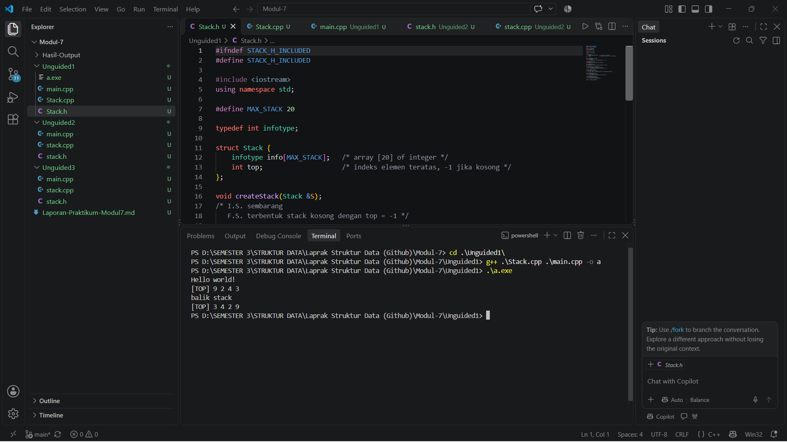
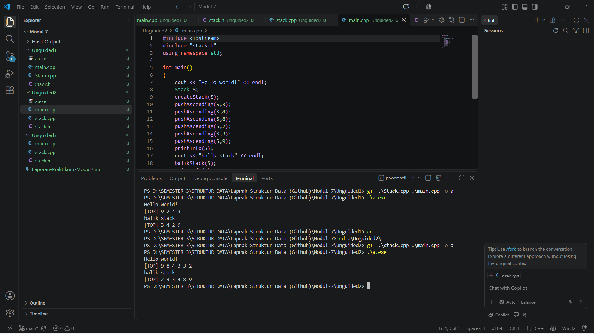
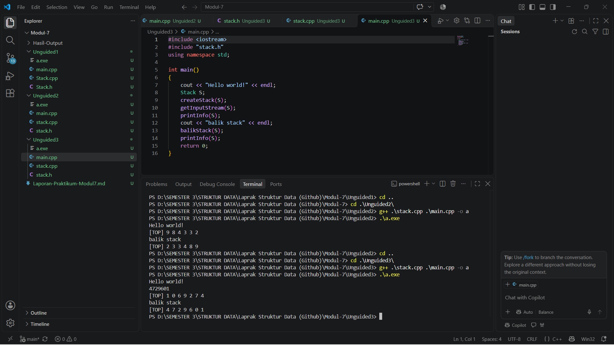

# <h1 align="center">Laporan Praktikum Modul 6 - STACK</h1>
<p align="center">Andhista Novian Firzatullah - 109082500092</p>

## Dasar Teori

A. Stack
Stack adalah struktur data yang bekerja seperti tumpukan. Elemen yang dapat diambil lebih dulu adalah elemen yang paling atas, yaitu elemen yang terakhir dimasukkan. Prinsip ini disebut LIFO (Last In First Out) [1]. Contoh sederhananya adalah tumpukan piring, di mana piring yang terakhir diletakkan di atas akan menjadi piring pertama yang diambil.

B. Komponen Stack
Komponen stack pada dasarnya sama dengan komponen singly linked list, tetapi akses data hanya dilakukan pada awal stack saja [1]. Bagian paling atas ini disebut Top, yaitu penunjuk yang menjadi satu-satunya jalan untuk mengakses data di dalam stack. Pada representasi pointer, setiap elemen (elmStack) terdiri dari info untuk menyimpan data dan next yang menunjuk ke elemen di bawahnya. Elemen terakhir menunjuk ke Nil, dan stack dinyatakan kosong jika Top bernilai Nil.

C. Operasi Dasar Stack
Stack memiliki dua operasi utama, yaitu Push dan Pop [1].

Push adalah operasi menyisipkan elemen ke tumpukan dan sama dengan insert first pada list biasa. Langkahnya adalah membuat elemen baru dengan alokasi, mengarahkan next elemen baru ke Top lama (P->next = S.Top), lalu memindahkan Top ke elemen baru (S.Top = P).

Pop adalah operasi mengambil elemen paling atas dan mirip dengan delete first pada list linear. Langkahnya adalah menyimpan elemen Top dalam P (P = S.Top), memindahkan Top ke elemen di bawahnya (S.Top = S.Top->next), lalu mengembalikan P.

D. Primitif Stack
Primitif stack pada dasarnya sama dengan primitif list lainnya, tetapi jumlahnya lebih sedikit karena operasi hanya dilakukan pada elemen paling atas [1]. Primitif yang digunakan antara lain createStack untuk membuat stack kosong, isEmpty untuk memeriksa apakah stack kosong, alokasi dan dealokasi untuk mengelola memori elemen, serta fungsi pencarian dan primitif lainnya. Seperti model list yang lain, primitif disimpan pada file .h (deklarasi) dan file .c atau .cpp (implementasi).

E. Stack Representasi Tabel (Array)
Prinsip stack dengan representasi tabel sama dengan representasi pointer. Perbedaannya ada pada struktur datanya, yaitu menggunakan array berindeks dengan jumlah tumpukan yang terbatas [1]. Batas maksimum tumpukan dinyatakan dengan Imax, dan Top berfungsi sebagai indeks elemen teratas. Pada representasi ini tidak diperlukan manajemen memori seperti alokasi dan dealokasi karena data disimpan langsung di dalam array.

Pada operasi Push, penyisipan dilakukan dengan menggeser Top ke indeks berikutnya (Top = Top + 1), lalu data disimpan pada indeks tersebut. Pada operasi Pop, data pada indeks Top disimpan ke variabel sementara (Temp = S.Info[Top]), kemudian Top bergeser ke indeks sebelumnya (Top = Top - 1) tanpa menghapus isi indeks lama [1].

Pada contoh modul, stack kosong ditandai dengan Top = 0 karena indeks dihitung mulai dari 1. Pada praktikum ini digunakan array C++ yang indeksnya dimulai dari 0, sehingga stack kosong ditandai dengan top = -1.

F. ADT Stack
ADT (Abstract Data Type) mendefinisikan struktur data beserta operasinya sebagai satu kesatuan. Pada praktikum ini ADT Stack dipisah menjadi file header (stack.h) yang berisi tipe data dan prototype, file implementasi (stack.cpp) yang berisi isi prosedur dan fungsi, serta file main.cpp untuk pengujian. Struktur yang digunakan adalah infotype (tipe data yang disimpan, yaitu integer) dan Stack, yaitu struct yang berisi array info berukuran 20 dan top sebagai penunjuk elemen teratas. Prosedur dan fungsi yang dibuat adalah createStack, push, pop (fungsi yang mengembalikan nilai elemen yang diambil), printInfo, dan balikStack.

G. Prosedur Tambahan
balikStack membalik urutan isi stack, sehingga elemen yang semula di dasar menjadi Top. Hal ini dapat dilakukan dengan menukar elemen dari kedua ujung array hingga bertemu di tengah. pushAscending menyisipkan elemen sambil menjaga isi stack tetap terurut menaik dari dasar ke Top, dengan menggeser elemen yang lebih besar dari nilai baru ke atas. getInputStream membaca input pengguna karakter demi karakter menggunakan cin.get() dan memasukkan setiap karakter ke stack sampai pengguna menekan enter.

## Guided 

### 1.Program STACK
```C++
// File: Stack.h
/* file : stack.h
   contoh ADT stack dengan representasi tabel */
#ifndef STACK_H_INCLUDED
#define STACK_H_INCLUDED

#include <iostream>
using namespace std;

struct infotype {
    char nim[20];
    char nama[20];
};
struct Stack {
    infotype info[10];
    int Top;
};

/* prototype */
/******** pengecekan apakah Stack kosong *********/
int isEmpty(Stack S);
/* mengembalikan nilai 0 jika stack kosong */

/******** pembuatan Stack ********/
void createStack(Stack &S);
/* I.S. sembarang
   F.S. terbentuk stack dengan Top=0 */

/******** penambahan elemen pada Stack ********/
void push(Stack &S, infotype X);
/* I.S. Stack mungkin kosong
   F.S. menambahkan elemen pada stack dengan nilai X, TOP=TOP+1 */

/******** penghapusan elemen pada Stack ********/
void pop(Stack &S, infotype &X);
/* I.S. stack tidak kosong
   F.S. nilai info pada indeks TOP disimpan pada X, kemudian TOP=TOP-1 */

/******** proses semua elemen Stack *********/
void viewStack(Stack S);
/* I.S. stack mungkin kosong
   F.S. jika stack tidak kosong menampilkan semua info yang ada pada stack
*/
#endif // STACK_H_INCLUDED

// File: Stack.cpp
#include "stack.h"

int isEmpty(Stack S) {
    /* Top = 0 berarti kosong, sesuai komentar di stack.h dikembalikan 0 */
    if (S.Top == 0) {
        return 0;
    } else {
        return 1;
    }
}

void createStack(Stack &S) {
    S.Top = 0;
}

void push(Stack &S, infotype X) {
    if (S.Top < 10) {
        S.Top = S.Top + 1;
        S.info[S.Top - 1] = X;   /* Top 1..10 dipetakan ke indeks array 0..9 */
    } else {
        cout << "Stack penuh, data tidak bisa ditambahkan" << endl;
    }
}

void pop(Stack &S, infotype &X) {
    if (isEmpty(S) != 0) {
        X = S.info[S.Top - 1];
        S.Top = S.Top - 1;
    } else {
        cout << "Stack kosong, tidak ada data yang bisa diambil" << endl;
    }
}

void viewStack(Stack S) {
    if (isEmpty(S) == 0) {
        cout << "Stack kosong" << endl;
    } else {
        cout << "Isi stack (dari TOP):" << endl;
        for (int i = S.Top; i >= 1; i--) {
            cout << i << ". " << S.info[i - 1].nim << " - "
                 << S.info[i - 1].nama << endl;
        }
    }
}

// File: main.cpp
#include <iostream>
#include <cstring>
#include "stack.h"
using namespace std;

int main() {
    Stack S;
    infotype data, hasil;

    createStack(S);
    cout << "Stack baru dibuat, Top = " << S.Top << endl;
    viewStack(S);

    cout << endl << "--- Push 3 data ---" << endl;
    strcpy(data.nim, "103112400001");
    strcpy(data.nama, "Andi");
    push(S, data);

    strcpy(data.nim, "103112400002");
    strcpy(data.nama, "Budi");
    push(S, data);

    strcpy(data.nim, "103112400003");
    strcpy(data.nama, "Citra");
    push(S, data);
    viewStack(S);

    cout << endl << "--- Pop 1 data ---" << endl;
    pop(S, hasil);
    cout << "Data yang diambil: " << hasil.nim << " - " << hasil.nama << endl;
    viewStack(S);

    cout << endl << "--- Pop sampai kosong ---" << endl;
    pop(S, hasil);
    pop(S, hasil);
    pop(S, hasil);
    viewStack(S);

    return 0;
}


```
Program ini menyimpan data mahasiswa (NIM dan nama) dalam sebuah stack yang dibuat dengan array berkapasitas 10 data. Pertama, createStack membuat stack kosong dengan Top = 0, sehingga saat ditampilkan program mencetak "Stack kosong". Kemudian tiga data dimasukkan dengan push, yaitu Andi, Budi, dan Citra. Setiap push menaikkan Top satu angka lalu menyimpan data di posisi tersebut, jadi setelah tiga kali push nilai Top adalah 3. Saat ditampilkan dengan viewStack, data muncul dari atas ke bawah: Citra, Budi, lalu Andi, karena data yang terakhir masuk berada paling atas (prinsip LIFO).

Setelah itu dilakukan pop satu kali. Data teratas, yaitu Citra, diambil dan disimpan di variabel hasil, lalu Top turun menjadi 2. Stack kini hanya berisi Budi dan Andi. Terakhir, pop dijalankan tiga kali. Dua pop pertama mengambil Budi lalu Andi, sedangkan pop ketiga gagal karena stack sudah kosong, sehingga program menampilkan pesan "Stack kosong, tidak ada data yang bisa diambil". Dengan begitu, program ini menunjukkan bahwa push dan pop hanya bekerja di bagian atas stack dan data keluar dengan urutan terbalik dari urutan masuknya.
## Unguided 

### 1. Program ADT Stack - CreateStack

```C++

File: Stack.h
#ifndef STACK_H_INCLUDED
#define STACK_H_INCLUDED

#include <iostream>
using namespace std;

#define MAX_STACK 20

typedef int infotype;

struct Stack {
    infotype info[MAX_STACK];   /* array [20] of integer */
    int top;                    /* indeks elemen teratas, -1 jika kosong */
};

void createStack(Stack &S);
/* I.S. sembarang
   F.S. terbentuk stack kosong dengan top = -1 */

bool isEmpty(Stack S);
/* mengembalikan true jika stack kosong */

bool isFull(Stack S);
/* mengembalikan true jika stack penuh (top = 19) */

void push(Stack &S, infotype x);
/* I.S. stack mungkin kosong, belum penuh
   F.S. x menjadi elemen teratas, top = top + 1 */

infotype pop(Stack &S);
/* I.S. stack tidak kosong
   F.S. top = top - 1, mengembalikan nilai elemen yang diambil */

void printInfo(Stack S);
/* I.S. stack mungkin kosong
   F.S. menampilkan isi stack dari TOP ke dasar */

void balikStack(Stack &S);
/* I.S. stack mungkin kosong
   F.S. urutan isi stack terbalik */

#endif // STACK_H_INCLUDED
File: Stack.cpp
#include "stack.h"

void createStack(Stack &S) {
    S.top = -1;
}

bool isEmpty(Stack S) {
    return S.top == -1;
}

bool isFull(Stack S) {
    return S.top == MAX_STACK - 1;
}

void push(Stack &S, infotype x) {
    if (isFull(S)) {
        cout << "Stack penuh, " << x << " tidak dapat dimasukkan" << endl;
    } else {
        S.top++;
        S.info[S.top] = x;
    }
}

infotype pop(Stack &S) {
    if (isEmpty(S)) {
        cout << "Stack kosong, pop gagal" << endl;
        return -1;
    }
    infotype x = S.info[S.top];
    S.top--;
    return x;
}

void printInfo(Stack S) {
    cout << "[TOP] ";
    for (int i = S.top; i >= 0; i--) {
        cout << S.info[i] << " ";
    }
    cout << endl;
}

void balikStack(Stack &S) {
    int i = 0, j = S.top;
    while (i < j) {
        infotype temp = S.info[i];
        S.info[i] = S.info[j];
        S.info[j] = temp;
        i++;
        j--;
    }
}

File: main.cpp
#include <iostream>
#include "stack.h"
using namespace std;

int main()
{
    cout << "Hello world!" << endl;
    Stack S;
    createStack(S);
    push(S,3);
    push(S,4);
    push(S,8);
    pop(S);
    push(S,2);
    push(S,3);
    pop(S);
    push(S,9);
    printInfo(S);
    cout << "balik stack" << endl;
    balikStack(S);
    printInfo(S);
    return 0;
}
```
### Output Unguided 1 :

##### Output 1


Program ini membuat stack berisi bilangan bulat dengan array berkapasitas 20 elemen. Saat stack dibuat dengan createStack, nilai top diatur ke -1 yang berarti stack masih kosong. Setiap kali push dipanggil, top naik satu angka lalu angka baru disimpan di posisi itu. Sebaliknya, pop mengambil angka di posisi top lalu menurunkan top satu angka. Sebelum push dan pop dijalankan, program memeriksa dulu dengan isFull dan isEmpty, jadi tidak akan terjadi data melebihi kapasitas atau mengambil data dari stack yang kosong.

Pada main, urutan prosesnya adalah sebagai berikut. Pertama, angka 3, 4, dan 8 dimasukkan, sehingga isi stack dari bawah ke atas adalah 3, 4, 8. Lalu pop membuang angka 8. Setelah itu angka 2 dan 3 dimasukkan, sehingga isinya menjadi 3, 4, 2, 3, kemudian pop membuang angka 3 yang paling atas. Terakhir angka 9 dimasukkan, sehingga isi akhir stack dari bawah ke atas adalah 3, 4, 2, 9.

Fungsi printInfo menampilkan isi stack mulai dari TOP ke bawah, jadi hasilnya [TOP] 9 2 4 3. Setelah itu balikStack membalik urutan isi stack dengan cara menukar elemen paling bawah dengan paling atas,

### 2.PushAscending

```C++
File: stack.h

#ifndef STACK_H_INCLUDED
#define STACK_H_INCLUDED

#include <iostream>
using namespace std;

#define MAX_STACK 20

typedef int infotype;

struct Stack {
    infotype info[MAX_STACK];   /* array [20] of integer */
    int top;                    /* indeks elemen teratas, -1 jika kosong */
};

void createStack(Stack &S);
/* I.S. sembarang
   F.S. terbentuk stack kosong dengan top = -1 */

bool isEmpty(Stack S);
/* mengembalikan true jika stack kosong */

bool isFull(Stack S);
/* mengembalikan true jika stack penuh (top = 19) */

void push(Stack &S, infotype x);
/* I.S. stack mungkin kosong, belum penuh
   F.S. x menjadi elemen teratas, top = top + 1 */

infotype pop(Stack &S);
/* I.S. stack tidak kosong
   F.S. top = top - 1, mengembalikan nilai elemen yang diambil */

void printInfo(Stack S);
/* I.S. stack mungkin kosong
   F.S. menampilkan isi stack dari TOP ke dasar */

void balikStack(Stack &S);
/* I.S. stack mungkin kosong
   F.S. urutan isi stack terbalik */

void pushAscending(Stack &S, infotype x);
/* I.S. stack sudah terurut menaik (dasar -> top)
   F.S. x disisipkan sehingga stack tetap terurut menaik dari dasar ke top */

#endif // STACK_H_INCLUDED
File: stack.cpp

#include "stack.h"

void createStack(Stack &S) {
    S.top = -1;
}

bool isEmpty(Stack S) {
    return S.top == -1;
}

bool isFull(Stack S) {
    return S.top == MAX_STACK - 1;
}

void push(Stack &S, infotype x) {
    if (isFull(S)) {
        cout << "Stack penuh, " << x << " tidak dapat dimasukkan" << endl;
    } else {
        S.top++;
        S.info[S.top] = x;
    }
}

infotype pop(Stack &S) {
    if (isEmpty(S)) {
        cout << "Stack kosong, pop gagal" << endl;
        return -1;
    }
    infotype x = S.info[S.top];
    S.top--;
    return x;
}

void printInfo(Stack S) {
    cout << "[TOP] ";
    for (int i = S.top; i >= 0; i--) {
        cout << S.info[i] << " ";
    }
    cout << endl;
}

void balikStack(Stack &S) {
    int i = 0, j = S.top;
    while (i < j) {
        infotype temp = S.info[i];
        S.info[i] = S.info[j];
        S.info[j] = temp;
        i++;
        j--;
    }
}

void pushAscending(Stack &S, infotype x) {
    if (isFull(S)) {
        cout << "Stack penuh, " << x << " tidak dapat dimasukkan" << endl;
        return;
    }
    /* geser elemen yang lebih besar dari x satu posisi ke atas */
    int i = S.top;
    while (i >= 0 && S.info[i] > x) {
        S.info[i + 1] = S.info[i];
        i--;
    }
    S.info[i + 1] = x;
    S.top++;
}
File: main.cpp
#include <iostream>
#include "stack.h"
using namespace std;

int main()
{
    cout << "Hello world!" << endl;
    Stack S;
    createStack(S);
    pushAscending(S,3);
    pushAscending(S,4);
    pushAscending(S,8);
    pushAscending(S,2);
    pushAscending(S,3);
    pushAscending(S,9);
    printInfo(S);
    cout << "balik stack" << endl;
    balikStack(S);
    printInfo(S);
    return 0;
}
```
### Output Unguided 2 :

##### Output 1


Program ini sama seperti program soal 1, tetapi ditambah prosedur pushAscending. Bedanya dengan push biasa, pushAscending tidak langsung menaruh angka di paling atas. Angka baru disisipkan di posisi yang tepat supaya isi stack selalu terurut naik dari dasar ke TOP, sehingga angka terbesar selalu berada di paling atas.

Caranya, prosedur memeriksa dulu apakah stack penuh. Jika tidak, ia menelusuri stack dari atas ke bawah. Setiap elemen yang lebih besar dari angka baru digeser satu posisi ke atas untuk memberi ruang. Penelusuran berhenti saat bertemu elemen yang lebih kecil atau sama dengan angka baru, atau saat sudah sampai dasar. Angka baru lalu ditaruh di celah yang tersedia, dan top naik satu angka.

Pada main, angka dimasukkan berurutan: 3, 4, 8, 2, 3, 9. Isi stack dari bawah ke atas berubah seperti ini:
- Setelah 3, 4, dan 8 dimasukkan: 3, 4, 8 (sudah naik, jadi tidak ada yang digeser).
- Setelah 2 dimasukkan: 2, 3, 4, 8 (semua elemen digeser ke atas karena 2 paling kecil).
- Setelah 3 dimasukkan: 2, 3, 3, 4, 8 (4 dan 8 digeser, lalu 3 ditaruh di atas 3 yang lama).
- Setelah 9 dimasukkan: 2, 3, 3, 4, 8, 9 (9 paling besar, jadi langsung di atas).

Saat printInfo dijalankan, stack ditampilkan dari TOP ke bawah sehingga hasilnya [TOP] 9 8 4 3 3 2, yang terlihat menurun dari atas. Setelah balikStack, urutannya terbalik menjadi [TOP] 2 3 3 4 8 9. Program ini menunjukkan bahwa stack bisa dijaga tetap terurut dengan menyisipkan data di posisi yang sesuai, bukan hanya di paling atas.

### 3. getInputStream

```C++
File: stack.h

#ifndef STACK_H_INCLUDED
#define STACK_H_INCLUDED

#include <iostream>
using namespace std;

#define MAX_STACK 20

typedef int infotype;

struct Stack {
    infotype info[MAX_STACK];   /* array [20] of integer */
    int top;                    /* indeks elemen teratas, -1 jika kosong */
};

void createStack(Stack &S);
/* I.S. sembarang
   F.S. terbentuk stack kosong dengan top = -1 */

bool isEmpty(Stack S);
/* mengembalikan true jika stack kosong */

bool isFull(Stack S);
/* mengembalikan true jika stack penuh (top = 19) */

void push(Stack &S, infotype x);
/* I.S. stack mungkin kosong, belum penuh
   F.S. x menjadi elemen teratas, top = top + 1 */

infotype pop(Stack &S);
/* I.S. stack tidak kosong
   F.S. top = top - 1, mengembalikan nilai elemen yang diambil */

void printInfo(Stack S);
/* I.S. stack mungkin kosong
   F.S. menampilkan isi stack dari TOP ke dasar */

void balikStack(Stack &S);
/* I.S. stack mungkin kosong
   F.S. urutan isi stack terbalik */

void getInputStream(Stack &S);
/* membaca input user per karakter (cin.get()) dan memasukkan
   tiap digit ke stack sampai user menekan enter */

#endif // STACK_H_INCLUDED
File: stack.cpp

#include "stack.h"

void createStack(Stack &S) {
    S.top = -1;
}

bool isEmpty(Stack S) {
    return S.top == -1;
}

bool isFull(Stack S) {
    return S.top == MAX_STACK - 1;
}

void push(Stack &S, infotype x) {
    if (isFull(S)) {
        cout << "Stack penuh, " << x << " tidak dapat dimasukkan" << endl;
    } else {
        S.top++;
        S.info[S.top] = x;
    }
}

infotype pop(Stack &S) {
    if (isEmpty(S)) {
        cout << "Stack kosong, pop gagal" << endl;
        return -1;
    }
    infotype x = S.info[S.top];
    S.top--;
    return x;
}

void printInfo(Stack S) {
    cout << "[TOP] ";
    for (int i = S.top; i >= 0; i--) {
        cout << S.info[i] << " ";
    }
    cout << endl;
}

void balikStack(Stack &S) {
    int i = 0, j = S.top;
    while (i < j) {
        infotype temp = S.info[i];
        S.info[i] = S.info[j];
        S.info[j] = temp;
        i++;
        j--;
    }
}

void getInputStream(Stack &S) {
    char c;
    while (cin.get(c) && c != '\n') {
        if (c >= '0' && c <= '9') {
            push(S, c - '0');
        }
    }
}
File: main.cpp
#include <iostream>
#include "stack.h"
using namespace std;

int main()
{
    cout << "Hello world!" << endl;
    Stack S;
    createStack(S);
    getInputStream(S);
    printInfo(S);
    cout << "balik stack" << endl;
    balikStack(S);
    printInfo(S);
    return 0;
}
```
### Output Unguided 3 :

##### Output 1


Program ini sama seperti program soal 1, tetapi ditambah prosedur getInputStream. Prosedur ini membuat stack bisa diisi langsung dari ketikan pengguna di keyboard, bukan dari angka yang sudah ditulis di dalam kode.

Cara kerjanya, getInputStream membaca ketikan pengguna satu karakter demi satu karakter dengan cin.get(). Setiap karakter yang dibaca diperiksa dulu. Jika karakter tersebut adalah angka 0 sampai 9, karakter itu diubah menjadi bilangan bulat dengan menguranginya dengan '0' (misalnya '4' menjadi 4), lalu dimasukkan ke stack dengan push. Karakter selain angka akan dilewati. Proses ini berulang terus sampai pengguna menekan enter, karena enter dibaca sebagai karakter '\n' yang menghentikan perulangan.

Sebagai contoh, saat pengguna mengetik 4729601 lalu enter, angka 4, 7, 2, 9, 6, 0, 1 masuk ke stack satu per satu. Karena angka 1 adalah yang terakhir masuk, ia berada di paling atas. Maka printInfo menampilkan [TOP] 1 0 6 9 2 7 4. Setelah balikStack dijalankan, urutannya terbalik menjadi [TOP] 4 7 2 9 6 0 1, yang sama dengan urutan angka yang diketik pengguna. Program ini menunjukkan bahwa stack membalik urutan data yang masuk, dan balikStack bisa dipakai untuk mengembalikannya ke urutan semula.


## Kesimpulan
Dari ketiga program di atas dapat disimpulkan bahwa stack adalah struktur data yang bekerja dengan prinsip LIFO (Last In First Out), yaitu data yang terakhir masuk menjadi data yang pertama keluar. Pada soal 1, stack dibuat dengan array berkapasitas 20 elemen dan dikelola oleh satu penunjuk bernama top. Operasi push menaikkan top lalu menyimpan data, sedangkan pop mengambil data teratas lalu menurunkan top. Prosedur balikStack juga berhasil membalik urutan isi stack, sehingga data yang semula di dasar menjadi data teratas.

Pada soal 2, prosedur pushAscending menunjukkan bahwa data dapat disisipkan di posisi yang tepat, bukan hanya di paling atas, sehingga isi stack selalu terurut naik dari dasar ke TOP. Pada soal 3, prosedur getInputStream menunjukkan bahwa stack dapat diisi langsung dari input pengguna dengan membaca karakter satu per satu menggunakan cin.get(). Hasilnya membuktikan bahwa urutan data keluar terbalik dari urutan masuknya.
Selain itu, pemisahan program menjadi stack.h, stack.cpp,
## Referensi
[1] Triase. (2020). Diktat Edisi Revisi : STRUKTUR DATA. Medan: UNIVERSTAS ISLAM NEGERI SUMATERA UTARA MEDAN. 
<br>[2] Indahyati, Uce., Rahmawati Yunianita. (2020). "BUKU AJAR ALGORITMA DAN PEMROGRAMAN DALAM BAHASA C++". Sidoarjo: Umsida Press. Diakses pada 10 Maret 2024 melalui https://doi.org/10.21070/2020/978-623-6833-67-4.
<br>[3] Modul 2 Struktur Data: Pengenalan Bahasa C++ (Bagian Kedua). Fakultas Informatika, Telkom University.
