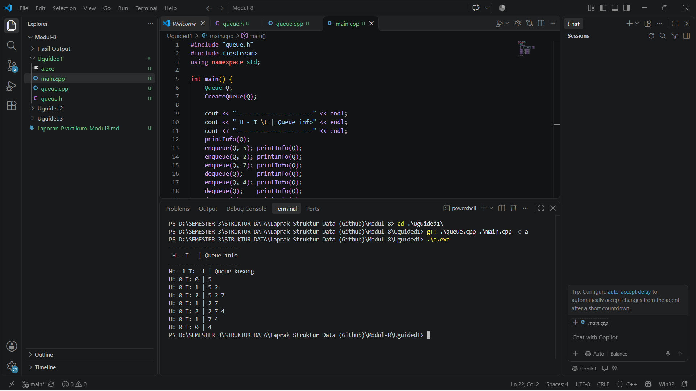
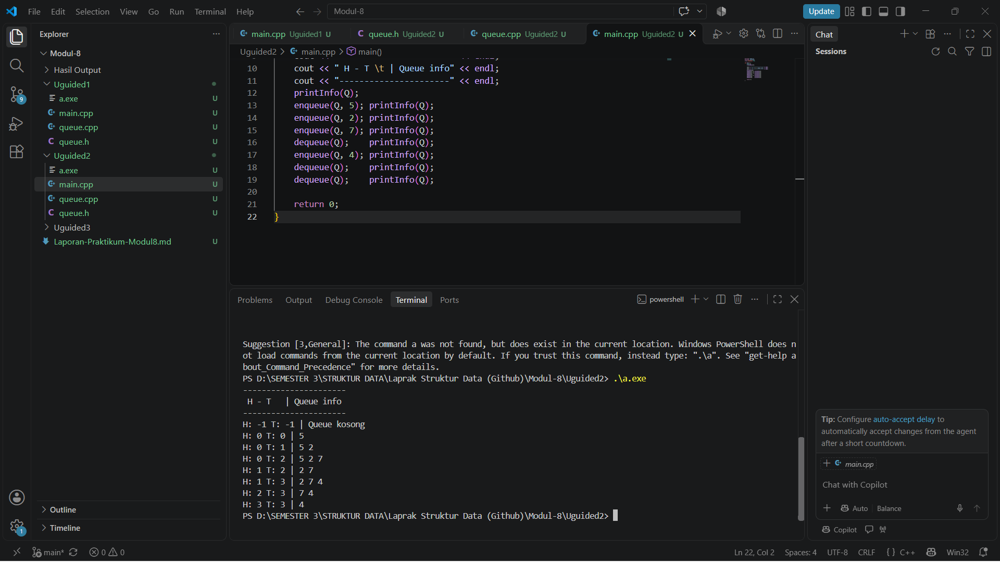
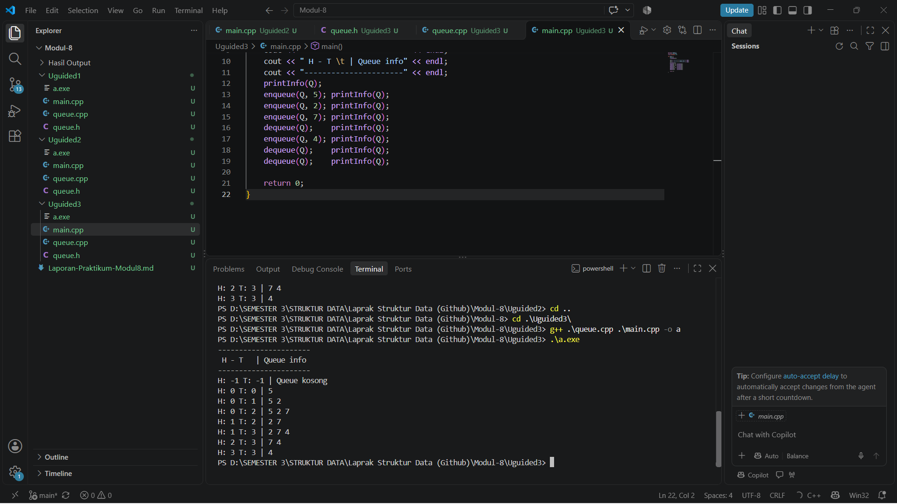

# <h1 align="center">Laporan Praktikum Modul 8 - QUEUE</h1>
<p align="center">Andhista Novian Firzatullah - 109082500092</p>

## Dasar Teori

Queue atau antrian adalah struktur data linear yang menggunakan prinsip FIFO (First In First Out). Elemen yang pertama kali dimasukkan akan menjadi elemen pertama yang dikeluarkan. Queue memiliki dua ujung, yaitu head/front sebagai posisi elemen pertama dan tail/rear sebagai posisi elemen terakhir. Operasi utama pada queue:

CreateQueue, untuk membuat queue kosong.
isEmpty, untuk mengecek apakah queue kosong.
isFull, untuk mengecek apakah queue penuh, biasanya digunakan pada queue statis/array.
enQueue atau insert, untuk menambahkan elemen ke posisi tail.
deQueue, untuk mengambil/menghapus elemen dari posisi head.
printInfo atau viewQueue, untuk menampilkan isi queue.
delAll, untuk menghapus seluruh elemen queue. Queue dapat direpresentasikan dengan dua cara:
1. Representasi pointer/linked list, yaitu menggunakan node yang memiliki info dan next, serta pointer head dan tail.
2. Representasi tabel/array, yaitu menggunakan array dan indeks head serta tail. Queue kosong biasanya ditandai dengan head = -1 dan tail = -1. Pada queue dinamis, penambahan elemen dilakukan dengan menyambungkan node baru setelah tail, sedangkan penghapusan dilakukan dengan memindahkan head ke head->next. Pada queue statis, penambahan dilakukan dengan menaikkan indeks tail, sedangkan penghapusan dapat dilakukan dengan memindahkan head atau menggeser elemen array tergantung implementasi yang digunakan.

## Guided 

### 1.Implementasi ADT Queue Dinamis dengan Linked List
```C++
File : queue.h
#ifndef QUEUE_H_INCLUDE
#define QUEUE_H_INCLUDE

#include <iostream>
#include <cstddef>

#define Nil nullptr

typedef int infotype;
typedef struct elmQ *address;

struct elmQ {
    infotype info;
    address  next;
};

/* Deklarasi tipe data queue: terdiri dari head dan tail.
   Queue kosong jika head = Nil */
struct queue {
    address head, tail;
};

/********* Pengecekan apakah queue kosong ***********/
bool isEmpty(queue Q);
/* Mengembalikan nilai true jika queue kosong */

/********* Pembuatan queue kosong *********/
void CreateQueue(queue &Q);
/* I.S. sembarang
   F.S. terbentuk queue kosong */

/********* Manajemen memori *********/
address alokasi(infotype X);
/* Mengirimkan address dari alokasi elemen.
   Jika alokasi berhasil, address tidak Nil;
   jika gagal, address bernilai Nil */

void dealokasi(address P);
/* I.S. P terdefinisi
   F.S. memori yang digunakan P dikembalikan ke sistem */

/********* Pencarian sebuah elemen *********/
address findElm(queue Q, infotype X);
/* Mencari apakah ada elemen queue dengan P->info = X.
   Jika ada, mengembalikan address elemen tersebut, dan Nil jika tidak */

bool fFindElm(queue Q, address P);
/* Mencari apakah ada elemen queue dengan alamat P.
   Mengembalikan true jika ada dan false jika tidak */

/********* Penambahan elemen **********/
void insert(queue &Q, address P);
/* I.S. sembarang, P sudah dialokasikan
   F.S. menempatkan elemen beralamat P pada akhir queue */

/********* Penghapusan sebuah elemen **********/
void deQueue(queue &Q, address &P);
/* I.S. queue tidak kosong
   F.S. P menunjuk elemen pertama queue; head queue menunjuk
        pada next elemen head yang lama. Queue mungkin menjadi kosong */

/********* Proses semua elemen queue **********/
void printInfo(queue Q);
/* I.S. queue mungkin kosong
   F.S. jika queue tidak kosong, menampilkan semua info pada queue */

int nbList(queue Q);
/* Mengembalikan jumlah elemen pada queue */

void delAll(queue &Q);
/* Menghapus semua elemen pada queue dan semua elemen di-dealokasi */

#endif
File : queue.cpp
#include "queue.h"
#include <iostream>
#include <new>

using namespace std;

bool isEmpty(queue Q) {
    return (Q.head == Nil);
}

void CreateQueue(queue &Q) {
    Q.head = Nil;
    Q.tail = Nil;
}

address alokasi(infotype X) {
    address P = new (nothrow) elmQ;
    if (P != Nil) {
        P->info = X;
        P->next = Nil;
    }
    return P;
}

void dealokasi(address P) {
    delete P;
}

address findElm(queue Q, infotype X) {
    address P = Q.head;
    while (P != Nil) {
        if (P->info == X) {
            return P;
        }
        P = P->next;
    }
    return Nil;
}

bool fFindElm(queue Q, address P) {
    address R = Q.head;
    while (R != Nil) {
        if (R == P) {
            return true;
        }
        R = R->next;
    }
    return false;
}

void insert(queue &Q, address P) {
    if (isEmpty(Q)) {
        Q.head = P;
        Q.tail = P;
    } else {
        Q.tail->next = P;
        Q.tail = P;
    }
}

void deQueue(queue &Q, address &P) {
    if (isEmpty(Q)) {
        P = Nil;
        return;
    }

    P = Q.head;
    if (Q.head == Q.tail) {
        Q.head = Nil;
        Q.tail = Nil;
    } else {
        Q.head = P->next;
    }
    P->next = Nil;
}

void delAll(queue &Q) {
    address P;
    while (!isEmpty(Q)) {
        deQueue(Q, P);
        dealokasi(P);
    }
}

void printInfo(queue Q) {
    if (isEmpty(Q)) {
        cout << "Queue kosong" << endl;
    } else {
        address P = Q.head;
        while (P != Nil) {
            cout << P->info << " ";
            P = P->next;
        }
        cout << endl;
    }
}

int nbList(queue Q) {
    int jumlah = 0;
    address P = Q.head;
    while (P != Nil) {
        jumlah++;
        P = P->next;
    }
    return jumlah;
}
File : main.cpp
#include <iostream>
#include "queue.h"
using namespace std;

int main() {
    queue Q;
    address P;

    CreateQueue(Q);
    cout << "isEmpty : " << isEmpty(Q) << endl;
    printInfo(Q);

    insert(Q, alokasi(5));
    insert(Q, alokasi(2));
    insert(Q, alokasi(7));
    cout << "Setelah insert 5, 2, 7" << endl;
    printInfo(Q);
    cout << "nbList : " << nbList(Q) << endl;

    P = findElm(Q, 2);
    if (P != Nil) {
        cout << "findElm(2) ketemu, info = " << P->info << endl;
        cout << "findElm : " << fFindElm(Q, P) << endl;
    }
    if (findElm(Q, 9) == Nil) {
        cout << "findElm(9) tidak ketemu" << endl;
    }

    deQueue(Q, P);
    cout << "Setelah delete, elemen yang keluar = " << P->info << endl;
    dealokasi(P);
    printInfo(Q);

    delAll(Q);
    cout << "Setelah delAll" << endl;
    printInfo(Q);
    cout << "isEmpty : " << isEmpty(Q) << endl;

    return 0;
}


```
Program ini mengimplementasikan queue dinamis menggunakan linked list. Struktur queue menyimpan pointer head dan tail. Fungsi CreateQueue menginisialisasi keduanya menjadi Nil. Fungsi alokasi membuat node baru, sedangkan insert menambahkan node di belakang queue melalui tail. Fungsi deQueue mengambil node paling depan, mengembalikan alamatnya melalui parameter P, lalu memindahkan head ke elemen berikutnya. Pada main, data 5, 2, dan 7 dimasukkan ke queue. Hasil pengecekan menunjukkan queue berisi 5 2 7. Setelah deQueue, elemen pertama yaitu 5 keluar sehingga queue menjadi 2 7. Setelah delAll, seluruh elemen dihapus dan queue kembali kosong.

### 2. Implementasi ADT Queue Statis dengan Array
```C++
File : queue.h
#ifndef QUEUE_H
#define QUEUE_H

#include <iostream>
using namespace std;

const int MAKSIMAL = 5;

struct queue {
    string nama[MAKSIMAL];
    int head;
    int tail;
};

bool isFull(queue Q);
bool isEmpty(queue Q);
void CreateQueue(queue &Q);
void enQueue(queue &Q, string nama);
void deQueue(queue &Q);
void viewQueue(queue Q);

#endif
File : queue.cpp
#include "queue.h"
#include <iostream>

using namespace std;

// NOTE : 
// Implementasi 1 = head diam, tail bergerak
// Implementasi 2 = head bergerak, tail bergerak
// Implementasi 3 = head dan tail berputar (Queue Circular)

bool isEmpty(queue Q){
    if(Q.head == -1 && Q.tail == -1){
        return true;
    } else {
        return false;
    }
}

// isFull implementasi 1 & 2
bool isFull(queue Q){
    if(Q.tail == MAKSIMAL - 1){
        return true;
    } else {
        return false;
    }
}

void CreateQueue(queue &Q){
    Q.head = -1;
    Q.tail = -1;
}

// enqueue implementasi 1 & 2
void enQueue(queue &Q, string nama){
    if(isFull(Q) == true){
        cout << "Queue sudah penuh!" << endl;
    } else {
        if(isEmpty(Q) == true){
            Q.head = Q.tail = 0;
        } else {
            Q.tail++;
        }
        Q.nama[Q.tail] = nama;
        cout << "nama " << nama << " berhasil ditambahkan kedalam queue!" << endl;
    }
}

// dequeue implementasi 1
void deQueue(queue &Q){
    if(isEmpty(Q) == true){
        cout << "Queue kosong!" << endl;
    } else {
        cout << "Mengahapus data " << Q.nama[Q.head] << "..." << endl;
        for(int i = 0; i < Q.tail; i++){
            Q.nama[i] =  Q.nama[i+1];
        }
        Q.tail--;
        if(Q.tail < 0){
            Q.head = -1;
            Q.tail = -1;
        }
    }
}

// viewQueue implementasi 1 & 2
void viewQueue(queue Q){
    if(isEmpty(Q) == true){
        cout << "Queue kosong!" << endl;
    } else {
        for(int i = Q.head; i <= Q.tail; i++){
            cout << i -  Q.head + 1 << ". " << Q.nama[i] << endl;
        }
    }
    cout << endl;
}
File : main.cpp
#include "queue.h"
#include <iostream>

using namespace std;

int main(){
    queue Q;

    CreateQueue(Q);
    enQueue(Q, "Dimas");
    enQueue(Q, "Arvin");
    enQueue(Q, "Rizal");
    enQueue(Q, "Hafizh");
    enQueue(Q, "Fathur");
    enQueue(Q, "Daffa");
    cout << endl;

    cout << "--- Isi Queue Setelah enQueue ---" << endl;
    viewQueue(Q);
    cout << endl;

    deQueue(Q);
    deQueue(Q);
    deQueue(Q);
    deQueue(Q);
    cout << endl;

    cout << "--- Isi Queue Setelah deQueue ---" << endl;
    viewQueue(Q);

    return 0;
}
```
Program ini mengimplementasikan queue statis menggunakan array berukuran MAKSIMAL = 5. Queue kosong ditandai dengan head = -1 dan tail = -1. Fungsi enQueue menambahkan data pada indeks tail. Jika queue masih kosong, head dan tail diatur menjadi 0. Jika queue sudah penuh, program menampilkan pesan "Queue sudah penuh!". Pada main, terdapat enam data yang akan dimasukkan, yaitu Dimas, Arvin, Rizal, Hafizh, Fathur, dan Daffa. Karena kapasitas queue hanya 5, data Daffa tidak masuk dan muncul pesan queue penuh. Fungsi deQueue pada implementasi ini menghapus elemen depan dengan menggeser seluruh elemen ke kiri, kemudian mengurangi tail. Setelah empat kali deQueue, data yang tersisa adalah Fathur.


## Unguided 

### 1. ADT Queue Array – Alternatif 1 (Head Diam, Tail Bergerak)

```C++

File : queue.h
#ifndef QUEUE_H_INCLUDE
#define QUEUE_H_INCLUDE

#include <iostream>
using namespace std;

const int MAX = 5;

struct Queue {
    int info[MAX];
    int head;
    int tail;
};

void CreateQueue(Queue &Q);
bool isEmptyQueue(Queue Q);
bool isFullQueue(Queue Q);
void enqueue(Queue &Q, int x);
int dequeue(Queue &Q);
void printInfo(Queue Q);

#endif
File : queue.cpp
#include "queue.h"
#include <iostream>
using namespace std;

void CreateQueue(Queue &Q) {
    Q.head = -1;
    Q.tail = -1;
}

bool isEmptyQueue(Queue Q) {
    return (Q.head == -1 && Q.tail == -1);
}

bool isFullQueue(Queue Q) {
    return (Q.tail == MAX - 1);
}

void enqueue(Queue &Q, int x) {
    if (isFullQueue(Q)) {
        cout << "Queue penuh!" << endl;
    } else {
        if (isEmptyQueue(Q)) {
            Q.head = 0;
            Q.tail = 0;
        } else {
            Q.tail++;
        }
        Q.info[Q.tail] = x;
    }
}

int dequeue(Queue &Q) {
    if (isEmptyQueue(Q)) {
        cout << "Queue kosong!" << endl;
        return -1;
    } else {
        int x = Q.info[Q.head];
        for (int i = Q.head; i < Q.tail; i++) {
            Q.info[i] = Q.info[i + 1];
        }
        Q.tail--;
        if (Q.tail < 0) {
            Q.head = -1;
            Q.tail = -1;
        }
        return x;
    }
}

void printInfo(Queue Q) {
    cout << "H: " << Q.head << " T: " << Q.tail << " | ";
    if (isEmptyQueue(Q)) {
        cout << "Queue kosong";
    } else {
        for (int i = Q.head; i <= Q.tail; i++) {
            cout << Q.info[i] << " ";
        }
    }
    cout << endl;
}
File : main.cpp
#include "queue.h"
#include <iostream>
using namespace std;

int main() {
    Queue Q;
    CreateQueue(Q);

    cout << "----------------------" << endl;
    cout << " H - T \t | Queue info" << endl;
    cout << "----------------------" << endl;
    printInfo(Q);
    enqueue(Q, 5); printInfo(Q);
    enqueue(Q, 2); printInfo(Q);
    enqueue(Q, 7); printInfo(Q);
    dequeue(Q);    printInfo(Q);
    enqueue(Q, 4); printInfo(Q);
    dequeue(Q);    printInfo(Q);
    dequeue(Q);    printInfo(Q);

    return 0;
}
```
### Output Unguided 1 :

##### Output 1


Program ini menunjukkan cara kerja struktur data Queue menggunakan prinsip FIFO. Setiap data yang masuk akan ditambahkan dari belakang (tail), sedangkan data yang keluar diambil dari depan (head).

### 2.ADT Queue Array – Alternatif 2 (Head Bergerak, Tail Bergerak)

```C++
File : queue.h
#ifndef QUEUE_H_INCLUDE
#define QUEUE_H_INCLUDE

#include <iostream>
using namespace std;

const int MAX = 5;

struct Queue {
    int info[MAX];
    int head;
    int tail;
};

void CreateQueue(Queue &Q);
bool isEmptyQueue(Queue Q);
bool isFullQueue(Queue Q);
void enqueue(Queue &Q, int x);
int dequeue(Queue &Q);
void printInfo(Queue Q);

#endif
File : queue.cpp
#include "queue.h"
#include <iostream>
using namespace std;

void CreateQueue(Queue &Q) {
    Q.head = -1;
    Q.tail = -1;
}

bool isEmptyQueue(Queue Q) {
    return (Q.head == -1 && Q.tail == -1);
}

bool isFullQueue(Queue Q) {
    return (Q.tail == MAX - 1);
}

void enqueue(Queue &Q, int x) {
    if (isFullQueue(Q)) {
        cout << "Queue penuh!" << endl;
    } else {
        if (isEmptyQueue(Q)) {
            Q.head = 0;
            Q.tail = 0;
        } else {
            Q.tail++;
        }
        Q.info[Q.tail] = x;
    }
}

int dequeue(Queue &Q) {
    if (isEmptyQueue(Q)) {
        cout << "Queue kosong!" << endl;
        return -1;
    } else {
        int x = Q.info[Q.head];
        if (Q.head == Q.tail) {
            Q.head = -1;
            Q.tail = -1;
        } else {
            Q.head++;
        }
        return x;
    }
}

void printInfo(Queue Q) {
    cout << "H: " << Q.head << " T: " << Q.tail << " | ";
    if (isEmptyQueue(Q)) {
        cout << "Queue kosong";
    } else {
        for (int i = Q.head; i <= Q.tail; i++) {
            cout << Q.info[i] << " ";
        }
    }
    cout << endl;
}
File : main.cpp
#include "queue.h"
#include <iostream>
using namespace std;

int main() {
    Queue Q;
    CreateQueue(Q);

    cout << "----------------------" << endl;
    cout << " H - T \t | Queue info" << endl;
    cout << "----------------------" << endl;
    printInfo(Q);
    enqueue(Q, 5); printInfo(Q);
    enqueue(Q, 2); printInfo(Q);
    enqueue(Q, 7); printInfo(Q);
    dequeue(Q);    printInfo(Q);
    enqueue(Q, 4); printInfo(Q);
    dequeue(Q);    printInfo(Q);
    dequeue(Q);    printInfo(Q);

    return 0;
}
```
### Output Unguided 2 :

##### Output 1


Program ini menerapkan prinsip FIFO. Penambahan data dilakukan melalui tail, sedangkan penghapusan dilakukan melalui head. Berbeda dengan versi sebelumnya, penghapusan data tidak perlu menggeser seluruh isi antrian.

### 3. ADT Queue Array – Alternatif 3 (Head dan Tail Berputar / Circular)

```C++
File : queue.h
#ifndef QUEUE_H_INCLUDE
#define QUEUE_H_INCLUDE

#include <iostream>
using namespace std;

const int MAX = 5;

struct Queue {
    int info[MAX];
    int head;
    int tail;
};

void CreateQueue(Queue &Q);
bool isEmptyQueue(Queue Q);
bool isFullQueue(Queue Q);
void enqueue(Queue &Q, int x);
int dequeue(Queue &Q);
void printInfo(Queue Q);

#endif
File : queue.cpp
#include "queue.h"
#include <iostream>
using namespace std;

void CreateQueue(Queue &Q) {
    Q.head = -1;
    Q.tail = -1;
}

bool isEmptyQueue(Queue Q) {
    return (Q.head == -1 && Q.tail == -1);
}

bool isFullQueue(Queue Q) {
    return ((Q.tail + 1) % MAX == Q.head);
}

void enqueue(Queue &Q, int x) {
    if (isFullQueue(Q)) {
        cout << "Queue penuh!" << endl;
    } else {
        if (isEmptyQueue(Q)) {
            Q.head = 0;
            Q.tail = 0;
        } else {
            Q.tail = (Q.tail + 1) % MAX;
        }
        Q.info[Q.tail] = x;
    }
}

int dequeue(Queue &Q) {
    if (isEmptyQueue(Q)) {
        cout << "Queue kosong!" << endl;
        return -1;
    } else {
        int x = Q.info[Q.head];
        if (Q.head == Q.tail) {
            Q.head = -1;
            Q.tail = -1;
        } else {
            Q.head = (Q.head + 1) % MAX;
        }
        return x;
    }
}

void printInfo(Queue Q) {
    cout << "H: " << Q.head << " T: " << Q.tail << " | ";
    if (isEmptyQueue(Q)) {
        cout << "Queue kosong";
    } else {
        int i = Q.head;
        while (true) {
            cout << Q.info[i] << " ";
            if (i == Q.tail) break;
            i = (i + 1) % MAX;
        }
    }
    cout << endl;
}
File : main.cpp
#include "queue.h"
#include <iostream>
using namespace std;

int main() {
    Queue Q;
    CreateQueue(Q);

    cout << "----------------------" << endl;
    cout << " H - T \t | Queue info" << endl;
    cout << "----------------------" << endl;
    printInfo(Q);
    enqueue(Q, 5); printInfo(Q);
    enqueue(Q, 2); printInfo(Q);
    enqueue(Q, 7); printInfo(Q);
    dequeue(Q);    printInfo(Q);
    enqueue(Q, 4); printInfo(Q);
    dequeue(Q);    printInfo(Q);
    dequeue(Q);    printInfo(Q);

    return 0;
}
```
### Output Unguided 3 :

##### Output 1


Circular Queue merupakan pengembangan dari Queue biasa yang memungkinkan ruang kosong di awal array digunakan kembali. Dengan bantuan operasi modulo (%), posisi head dan tail dapat berputar dari indeks terakhir kembali ke indeks 0 tanpa perlu menggeser data.


## Kesimpulan
Berdasarkan ketiga program yang telah dibuat, dapat disimpulkan bahwa Queue menggunakan prinsip FIFO (First In, First Out), yaitu data yang pertama masuk akan menjadi data pertama yang keluar. Perbedaannya terletak pada cara menghapus dan mengelola data. Queue pertama menggunakan pergeseran data, Queue kedua hanya memindahkan posisi head, sedangkan Circular Queue menggunakan operasi modulo (%) agar ruang kosong dapat digunakan kembali secara melingkar. Dari ketiganya, Circular Queue lebih efisien dalam memanfaatkan kapasitas array karena tidak memerlukan pergeseran data.
## Referensi
[1] Triase. (2020). Diktat Edisi Revisi : STRUKTUR DATA. Medan: UNIVERSTAS ISLAM NEGERI SUMATERA UTARA MEDAN. 
<br>[2] Indahyati, Uce., Rahmawati Yunianita. (2020). "BUKU AJAR ALGORITMA DAN PEMROGRAMAN DALAM BAHASA C++". Sidoarjo: Umsida Press. Diakses pada 10 Maret 2024 melalui https://doi.org/10.21070/2020/978-623-6833-67-4.
<br>[3] Modul 2 Struktur Data: Pengenalan Bahasa C++ (Bagian Kedua). Fakultas Informatika, Telkom University.
